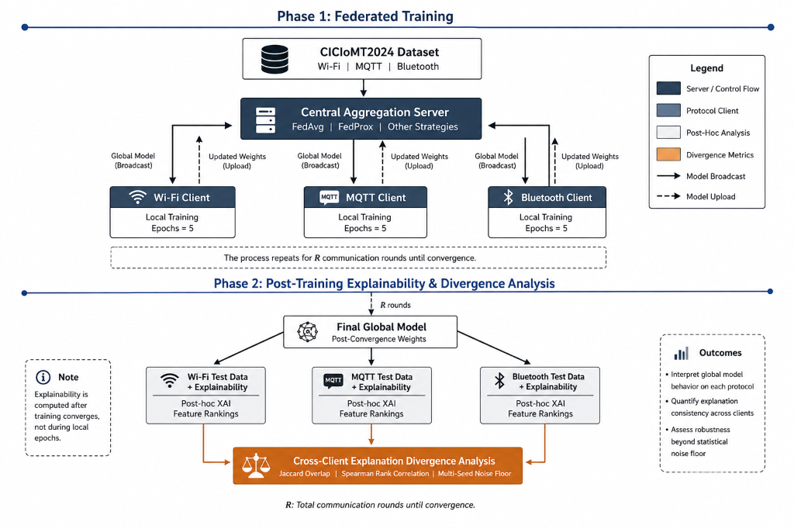

# FedXplain-IoMT: Federated Learning & Explainable AI for Heterogeneous Medical IoT

[](https://www.python.org/downloads/)
[](https://pytorch.org/)
[](https://flower.ai/)
[](https://shap.readthedocs.io/)
[](https://www.unb.ca/cic/datasets/iomt-dataset-2024.html)
[](https://streamlit.io/)

**FedXplain-IoMT** is an empirical research framework investigating **cross-client explanation divergence** in Federated Learning (FL) for Internet of Medical Things (IoMT) intrusion detection. While conventional federated evaluation focuses exclusively on global accuracy and F1 scores, FedXplain-IoMT evaluates whether a converged global model relies on fundamentally disjoint or consistent decision logic across hospital clients operating on heterogeneous physical network protocols (Wi-Fi, MQTT, Bluetooth). Using post-hoc feature attributions (SHAP) and multidimensional divergence metrics (Jaccard similarity, Spearman rank correlation, cosine similarity), this project provides quantitative and visual evidence of explanatory drift in privacy-preserving clinical device environments.

---

## 1. The Problem in Plain Language

Hospitals cannot pool raw patient and device network traffic onto a central server due to strict healthcare privacy regulations (HIPAA, GDPR), making Federated Learning necessary for collaborative defense. However, modern medical facilities deploy devices operating across physically dissimilar communication protocols—such as high-throughput Wi-Fi telemetry monitors, lightweight MQTT bedside sensors, and short-range Bluetooth diagnostic peripherals. Forcing these structurally conflicting network behaviors into a single shared neural network creates an unseen failure mode: a global model may achieve acceptable accuracy numbers on paper while relying on completely disjointed or contradictory reasons to flag attacks on different wards. When clinicians and hospital security teams cannot rely on consistent decision logic across departments, automated network containment policies cannot be safely trusted.

---

## 2. Key Findings

> ### 📌 Headline Empirical Findings (Seeds 42 & 7)
>
> - **No $\mu$ saves Bluetooth**: Under standard FedAvg, Bluetooth benign recall collapses to **0.3666** (seed 42) and **0.4238** (seed 7). Across the entire FedProx proximal sweep ($\mu \in \{0.001, 0.01, 0.05, 0.1\}$), proximal regularization makes the collapse strictly worse (**0.0073–0.2090**), flagging 97–99% of benign Bluetooth packets as attacks. Model sharing drives the collapse, and proximal anchoring deepens it.
> - **Local-only outperforms all sharing on detection (0.9708 vs 0.7988 avg macro F1)**: Isolated models trained completely without federation achieve an average macro F1 of **0.9715** (seed 42) and **0.9702** (seed 7) with **0.9984 / 0.9990** Bluetooth benign recall. Training alone completely avoids the collapse and beats every tested federated sharing strategy (+0.1720 vs FedAvg, +0.0467 vs FedPer).
> - **FedPer's measured trade-off position**: Personalizing the final output layer (keeping trunk shared) recovers **72.7%** (seed 42) and **77.9%** (seed 7) of the Bluetooth benign recall gap (reaching **0.8258 / 0.8721**) and retains **95.2%** of local-only's detection quality (**0.9241** two-seed mean avg macro F1), while preserving FedAvg-level cross-client explanation consistency ($\rho \ge 0.89$ vs FedAvg across all clients).
>
> Full tabular results and publication figures are documented in [`docs/final_results.md`](docs/final_results.md).

---

## 3. Method Lineup

| Method | What It Is | What It Tests | Status |
|---|---|---|:---:|
| **FedAvg** | Standard federated averaging aggregating full model weights sample-count-weighted each round. | Baseline shared-model detection accuracy and cross-client attribution divergence under heterogeneous protocols. | Completed |
| **FedProx** | Proximal regularization penalizing local client drift from global weights ($\mu \in \{0.001, 0.01, 0.05, 0.1\}$). | Tests whether penalizing parameter divergence prevents explanatory drift or rescues minority protocol performance. | Completed |
| **Local-only** | Isolated per-client training (30 epochs matching federated compute) with zero weight sharing. | Control baseline ("does federating help or hurt?") and empirical reference for heterogeneous clients. | Completed |
| **FedPer** | Personalized FL sharing the 4-array trunk (45→64, 64→32) while keeping the 2-array head (32→1) private. | Tests whether personalizing output boundaries restores local calibration while maintaining trunk representation sharing. | Completed |
| **Cluster-FL** | Clustered federated learning grouping structurally similar protocols into separate clusters. | Evaluates whether protocol-aware clustering achieves personalization without private head divergence. | *In progress (slot ready)* |

---

## 4. System Architecture



### 6-Step End-to-End Pipeline

1. **Data Ingestion & Schema Guardrails**: Network flow records from CICIoMT2024 (Wi-Fi, MQTT, Bluetooth) are ingested from CSVs, stripped of identifier/leakage columns (IPs, MACs, timestamps), and validated against the strict 45-feature schema.
2. **Stratified Split & Scaling**: Partitions are divided 80/20 with label stratification (`stratify=y`). A `StandardScaler` is fitted strictly on training data and applied to test data to prevent data snooping.
3. **Federated Optimization**: Clients execute mini-batch SGD on PyTorch models over 10 communication rounds using Flower/custom loops under selected aggregation methods (FedAvg, FedProx, FedPer, or Local-only control).
4. **Post-Hoc Attribution (SHAP)**: Converged global or personalized models are explained on held-out attack samples using `shap.DeepExplainer` with 100 protocol-specific benign samples as background reference.
5. **Divergence Quantification**: Attributions are evaluated pairwise across clients using Top-5 Jaccard overlap, Spearman rank correlation ($\rho$), and cosine similarity on full 45-dimensional mean-$|\text{SHAP}|$ vectors.
6. **Interactive Dashboard**: Experiment payloads are validated and rendered in a 5-tab BCG-style Streamlit dashboard (`app.py`) for comparative analysis, noise floor calibration, and visual reporting.

---

## 5. Repository Map

```
FedXplain-IoMT/
├── app.py                              # Interactive 5-tab Streamlit research dashboard
├── requirements.txt                    # Pinned package dependencies for Python 3.14
├── README.md                           # Master front-door documentation
├── data/
│   ├── README.md                       # CICIoMT2024 dataset documentation
│   ├── poc/                            # Sampled POC subsets (~10k rows total)
│   │   ├── bluetooth_poc.csv
│   │   ├── mqtt_poc.csv
│   │   └── wifi_poc.csv
│   └── study/                          # Full study partitions (~166k rows total)
│       ├── bluetooth_study.csv         # 16,346 rows (13,076 train / 3,270 test)
│       ├── mqtt_study.csv              # 49,997 rows (39,997 train / 10,000 test)
│       └── wifi_study.csv              # 99,993 rows (79,994 train / 19,999 test)
├── docs/
│   ├── agent_fix_report.md             # Engineering history & environment pinning notes
│   ├── final_results.md                # Comprehensive result tables and figures
│   ├── poc_summary.md                  # Preliminary pilot summary report
│   ├── qa_findings.md                  # Formal QA correctness audit findings & evidence
│   ├── system_architecture.png         # Publication architecture diagram
│   └── ui_guide.md                     # Dashboard UI structure and presentation guide
├── figures/                            # Publication-quality 300-DPI PNG figures
│   ├── fig1_detection_macro_f1.png     # Per-client detection quality by method
│   ├── fig2_spearman_divergence_heatmap.png # Cross-client Spearman agreement & noise floor
│   ├── fig3_bluetooth_mu_sweep.png     # Bluetooth benign recall vs FedProx mu
│   └── fig4_tradeoff_scatter.png       # Detection quality vs explanation consistency
├── models/                             # Saved PyTorch model checkpoints (.pth) [gitignored]
├── results/
│   ├── cluster_fl_results.json         # Drop-in path for teammate's Cluster-FL runs (pending)
│   ├── divergence_report.md            # POC FedAvg divergence report
│   ├── divergence_report_fedprox.md    # POC FedProx divergence report
│   ├── fedavg_vs_fedprox_comparison.md # POC comparative analysis
│   ├── shap_*.png                      # Individual SHAP attribution plots
│   └── study_results.json              # Master JSON payload (single source of truth)
├── scripts/
│   ├── audit_results.py                # Completeness matrix validator (exit 0 on pass)
│   ├── backfill_completions.py         # Idempotent derived-key backfiller
│   ├── make_figures.py                 # Regenerates all 4 publication figures from JSON
│   ├── test_dashboard.py               # Streamlit AppTest headless verification script
│   └── validate_results.py             # Schema & value-range validator (exit 0 on pass)
└── src/
    ├── __init__.py
    ├── centralized.py                  # Pooled data centralized baseline benchmark
    ├── client.py                       # Flower NumPyClient with proximal regularization
    ├── config.py                       # Centralized experiment hyperparameters
    ├── explain.py                      # SHAP DeepExplainer & divergence calculation
    ├── explain_prox.py                 # FedProx explainability wrapper
    ├── merge_cluster_fl.py             # Merge utility for teammate Cluster-FL runs
    ├── model.py                        # IoMTMLP 3-layer neural network architecture
    ├── run_federated.py                # FedAvg orchestration runner
    ├── run_federated_prox.py           # FedProx orchestration runner
    ├── run_fedper.py                   # FedPer (personalized FL) orchestration runner
    ├── run_local_only.py               # Local-only (no sharing) control baseline
    ├── run_study_experiments.py        # Master suite orchestrator (centralized + FL + local + SHAP)
    └── utils.py                        # Data ingestion, scaling, caching & 45-feature guardrails
```

---

## 6. Reproduction Guide

Follow these exact steps to reproduce the environment, experiments, and results:

### Step 1: Clone Repository & Verify Python Environment
Ensure **Python 3.14** (tested on 3.14.7, 64-bit CPU):
```bash
git clone https://github.com/Swayam-Swaroop-Sahu/FedXplain-IoMT.git
cd FedXplain-IoMT
python --version
# Expected: Python 3.14.x
```

### Step 2: Install Pinned Dependencies
Install the exact pinned dependencies:
```bash
pip install -r requirements.txt
```
*Key pinned versions*: `torch==2.14.1`, `flwr==1.39.0`, `shap==0.53.0`, `scikit-learn==1.9.1`, `pandas==3.0.6`, `scipy==1.18.1`, `streamlit==1.65.0`, `plotly==7.1.0`.

### Step 3: Run Master Experiment Suite
Execute the full experimental suite (centralized baseline + 10 federated runs + 2 local-only runs + 2 FedPer runs + SHAP pipeline):
```bash
python -m src.run_study_experiments
```
*Expected Runtime*: Approximately **75 minutes** on modern multi-core CPU.  
*Environment note*: Minor numerical differences ($\le \pm 0.1$ macro F1) can occur across different operating system BLAS/MKL builds (as documented in `docs/agent_fix_report.md`).

### Step 4: Verify Results Integrity & Completeness
Run the automated QA validators to confirm schema compliance and matrix completeness:
```bash
python scripts/validate_results.py
python scripts/audit_results.py
```
Both commands must exit with status code 0 (`PASS`).

### Step 5: Regenerate Publication Figures
Regenerate all 4 figures from the results file:
```bash
python scripts/make_figures.py
```
Output files will be written to `figures/`.

### Step 6: Launch the Research Dashboard
Launch the offline interactive dashboard:
```bash
streamlit run app.py
```
Dashboard will open at `http://localhost:8501`.

---

## 7. Results File Schema (`results/study_results.json`)

The master payload `results/study_results.json` serves as the single source of truth for the dashboard, reports, and figure generation. Below is the key-by-key structure:

- **`run_metadata`** (`dict`): Experiment metadata including `n_rounds` (10), `n_local_epochs` (3), `data_dir` ("data/study"), `seeds` ([42, 7]), `mu_values` ([0.001, 0.01, 0.05, 0.1]), and execution timestamp.
- **`centralized`** (`dict`): Pooled dataset reference metrics for seed 42 (`f1_macro`, `f1_binary`, `accuracy`, `benign_recall`, `confusion_matrix`, etc.).
- **`centralized_by_seed`** (`dict`): Mapping from seed string (`"42"`, `"7"`) to pooled reference evaluation metrics.
- **`poc_baseline_reference`** (`dict`): Historical small-scale POC benchmark figures for reference.
- **`runs`** (`list[dict]`): List of 12 federated experiment objects (10 FedAvg/FedProx runs + 2 FedPer runs). Each entry contains:
  - `seed` (`int`): Random seed (42 or 7).
  - `aggregator` (`str`): `"fedavg"`, `"fedprox"`, or `"fedper"`.
  - `mu` (`float | None`): Proximal regularization coefficient (or `None`).
  - `client_metrics` (`dict`): Per-protocol metrics for `"wifi"`, `"mqtt"`, and `"bluetooth"`, each with `f1_macro`, `f1_binary`, `accuracy`, `benign_precision`, `benign_recall`, `attack_precision`, `attack_recall`, and confusion counts `tn, fp, fn, tp`.
  - `shap_top10_per_client` (`dict`): List of 10 `[feature_name, mean_abs_shap]` pairs per client.
  - `shap_top5_per_client` (`dict`): List of top 5 feature name strings per client.
  - `shap_full_vectors_per_client` (`dict`): Complete 45-feature vectors per client (`"feature_names"` and `"values"`).
  - `jaccard_pairwise` (`dict`): Top-5 Jaccard overlap for `"wifi-mqtt"`, `"wifi-bluetooth"`, and `"mqtt-bluetooth"`.
  - `divergence_full` (`dict`): Full-vector Spearman $\rho$ and cosine similarity per pair.
  - `shared_features` (`dict`): Shared top-5 feature names per pair.
  - `avg_macro_f1` (`float`, FedPer only): Mean macro F1 across the 3 clients.
  - `fedper_vs_fedavg` (`dict`, FedPer only): Client-by-client comparison of FedPer attributions vs FedAvg.
  - `fedper_vs_local_only` (`dict`, FedPer only): Client-by-client comparison of FedPer attributions vs Local-only.
- **`local_only`** (`list[dict]`): List of local-only isolated runs for seeds 42 and 7 (same metric and attribution schema as federated runs).
- **`local_vs_global`** (`dict`): Comparison of local-only explanations vs global FedAvg explanations for seeds 42 and 7 (`"top5_jaccard"`, `"spearman"`, `"cosine"` per protocol).
- **`preliminary_noise_floor`** (`dict`): Seed-to-seed stability metrics for each method:
  - `per_client_top5_stability`: Top-5 agreement between seed 42 and seed 7 per protocol.
  - `pairwise_divergence_spread`: Absolute difference between seed 42 and seed 7 Jaccard values.
  - `full_metric_spread`: Absolute difference in Spearman $\rho$ and cosine similarity between seeds.
- **`divergence_summary`** (`dict`): Consolidated matrix summarizing all methods, seeds, and client pairs with noise floor spreads, including the graceful placeholder for `"cluster_fl"`.

### Cluster-FL Teammate Drop-in Specification
To merge Cluster-FL results, a teammate drops a JSON array at `results/cluster_fl_results.json` adhering to `CLUSTER_FL_RUN_SCHEMA` (in `src/run_study_experiments.py`):
```json
[
  {
    "aggregator": "cluster_fl",
    "seed": 42,
    "mu": null,
    "clusters": {"wifi": 0, "mqtt": 0, "bluetooth": 1},
    "client_metrics": { ... },
    "avg_macro_f1": 0.9250,
    "shap_top10_per_client": { ... },
    "shap_top5_per_client": { ... },
    "shap_full_vectors_per_client": { ... },
    "jaccard_pairwise": { ... },
    "divergence_full": { ... },
    "shared_features": { ... },
    "divergence_scope": "across cluster-personalized models"
  }
]
```
Then run `python src/merge_cluster_fl.py`. No additional codebase changes are required.

---

## 8. Known Limitations

1. **Two Random Seeds ($n = 2$)**: All claims in this benchmark are directional rather than formal statistical inferences. While seed spreads and noise floors are explicitly quantified, variance bounds represent min-max ranges rather than standard deviations.
2. **Binary Classification Focus**: Models are evaluated on binary intrusion detection (attack vs benign). Attack granularity (e.g., distinguishing DDoS-SYN from DDoS-UDP or MQTT Connect Flood) is not evaluated.
3. **Dataset Scope**: The study is scoped to the Canadian Institute for Cybersecurity CICIoMT2024 flow benchmark. Physical IoT device constraints (embedded MCU RAM, CPU thermal throttling) are simulated logically rather than tested on bare metal.
4. **Environment Wobble ($\pm 0.1$)**: Disparate PyTorch, BLAS, and NumPy compilation builds on different OS architectures can introduce slight floating-point variations in local SGD convergence trajectories.

---

## 9. Project Roadmap

- [ ] **Phase 1: Cluster-FL Drop-in Port**: Merge teammate Cluster-FL runs into `results/cluster_fl_results.json` and validate against the divergence summary.
- [ ] **Phase 2: Advanced Federated Aggregators**: Benchmark SCAFFOLD (control variates for client drift), FedNova (normalized averaging for heterogeneous epochs), and FedOpt (adaptive server momentum).
- [ ] **Phase 3: Client Partition Scale-up**: Transition from 3 physical protocol silos to $K \ge 10$ virtual hospital clinic subnets with non-IID protocol distributions.
- [ ] **Phase 4: Full Seed Calibration**: Scale evaluation from 2 pilot seeds to 10 random seeds to establish statistical significance testing (p-values, 95% confidence intervals).

---

## 10. Citation & Attribution

If you utilize this framework or the extracted CICIoMT2024 partitions, please cite:
- **CICIoMT2024 Dataset**: Canadian Institute for Cybersecurity (CIC), University of New Brunswick.
- **Repository**: [Swayam-Swaroop-Sahu/FedXplain-IoMT](https://github.com/Swayam-Swaroop-Sahu/FedXplain-IoMT)